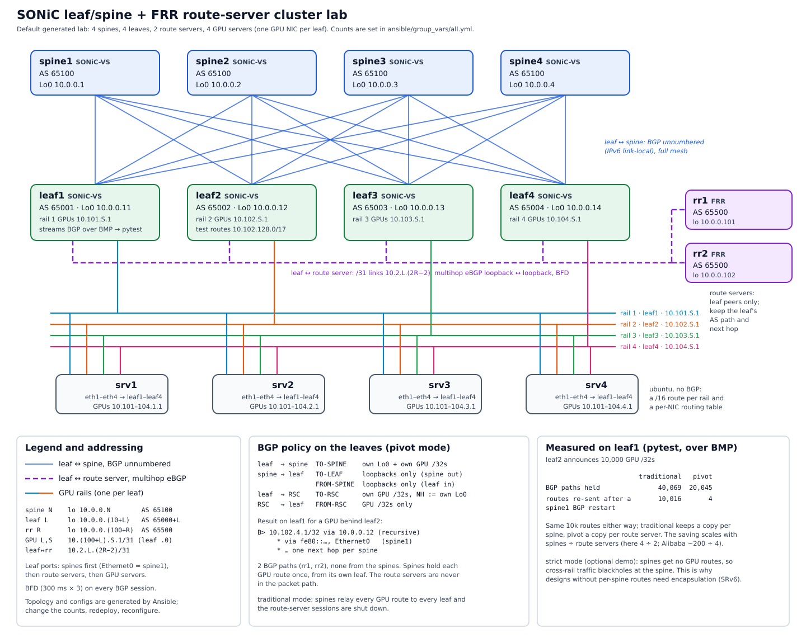

# sonic-rr: HPN Pivot lab

A containerlab reproduction of Alibaba's "HPN Pivot" (OCP 2026). Leaves learn GPU service routes
from a route-server cluster (FRR) over multihop eBGP, with a loopback next hop resolved recursively
over a SONiC spine underlay. They never learn GPU routes from the spines.



The design, addressing, predicted routing tables and switch route-scale notes are in [PLAN.md](PLAN.md).

## Nodes
| Node | Image | Role |
|---|---|---|
| spine1/2 | docker-sonic-vs | AS 65100, BGP unnumbered to leaves |
| leaf1/2 | docker-sonic-vs | AS 65001 / 65002, all route policy lives here |
| rr1/2 | quay.io/frrouting/frr:10.2.1 | AS 65500 route servers (RSC-BGP), leaf peers only |
| srv1-4 | gpu-server (ubuntu 24.04) | gpu0 → leaf1 (rail 0), gpu1 → leaf2 (rail 1), no BGP |

## Build and deploy
```bash
# 1. images (one time)
curl -fL -o images/docker-sonic-vs.gz \
  "https://sonic-build.azurewebsites.net/api/sonic/artifacts?branchName=master&platform=vs&target=target/docker-sonic-vs.gz"
docker load < images/docker-sonic-vs.gz
docker pull quay.io/frrouting/frr:10.2.1
docker build -t gpu-server:latest server/

# 2. lab
containerlab deploy -t topo.clab.yml
./configure.sh                 # MODE=pivot (default)
./compare.sh                   # route tables, BGP summaries, server tables, ping/traceroute
```
The RRs and servers are configured at deploy time (`rr/*.conf`, `exec:` in the topology).
`configure.sh` configures the SONiC nodes: it waits for each one to boot, then applies the SONiC
CLI and FRR config.

## Modes
```bash
./configure.sh                 # MODE=pivot (default): spines hold each GPU /32 once; cross-rail works
MODE=strict ./configure.sh     # spines get loopbacks only; cross-rail traffic blackholes at the spine
```
configure.sh soft-clears BGP at the end, so switching modes on a running lab takes effect right away.

In both modes the spines send only loopbacks down (`TO-LEAF out`, with `FROM-SPINE in` on the leaves
as a safety net). Leaves send the RSC only their own GPU /32s (`MY-GPU`). Leaves learn GPU routes
exclusively from rr1/rr2.

## Looking around
```bash
docker exec -it clab-sonic-rr-leaf1 vtysh          # FRR shell on a switch
docker exec -it clab-sonic-rr-leaf1 bash           # SONiC shell (show ip route, show interfaces status)
docker exec -it clab-sonic-rr-rr1 vtysh            # route server
docker exec -it clab-sonic-rr-srv1 bash            # GPU server
```
| What | Command (in vtysh) |
|---|---|
| FRR config | `show running-config` (BGP only: `show running-config bgpd`) |
| BGP peers | `show bgp ipv4 unicast summary` |
| Paths for one GPU | `show bgp ipv4 unicast 10.100.130.1/32` |
| What a leaf sends a spine | `show bgp ipv4 unicast neighbors Ethernet0 advertised-routes` |
| What a leaf took from an RR | `show bgp ipv4 unicast neighbors 10.0.0.101 routes` |
| Policy hit counts | `show route-map TO-SPINE` |

LLDP (the CDP equivalent) runs on the SONiC nodes. Run `lldpcli` inside the container:
```bash
docker exec clab-sonic-rr-leaf1 lldpcli show neighbors summary
```
SONiC's `show lldp table` doesn't work in sonic-vs: its wrapper calls `sudo docker exec lldp ...`,
and sonic-vs runs everything in one container. The RRs and servers don't run LLDP.

GPU server data-plane tests:
```bash
ping 10.100.3.1                                  # same rail, works in both modes
ping -I 10.100.1.1 10.100.130.1                  # cross rail via spine (fails in strict mode)
traceroute -n -s 10.100.1.1 10.100.130.1
```

## Teardown
```bash
containerlab destroy -t topo.clab.yml --cleanup
```

## Known quirks
- On the RRs, vtysh warns about a missing `/etc/frr/vtysh.conf`. It's harmless.
